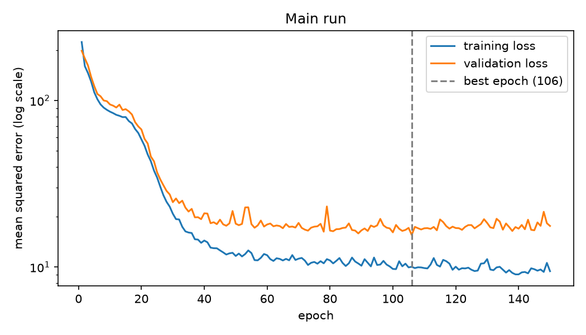
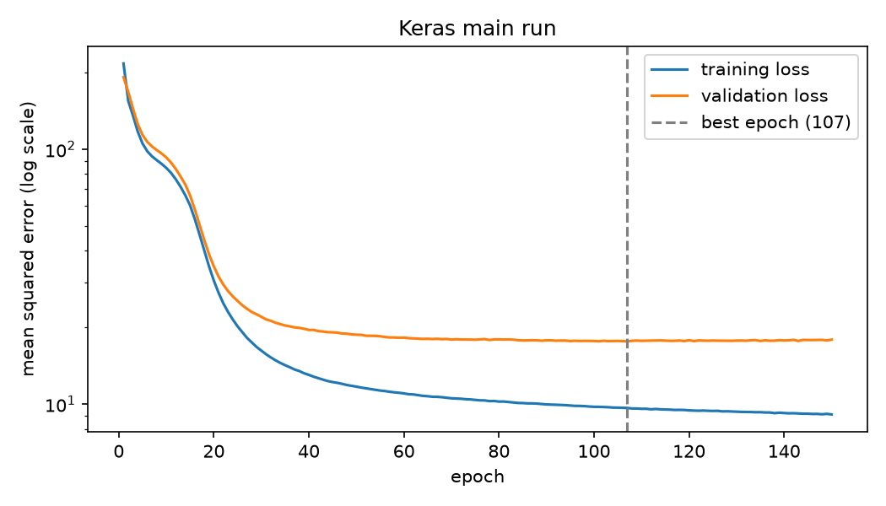

# Lakeshore Bike Demand: the same model in PyTorch and Keras

## What it does

This project predicts how many bikes will be rented at a Lakeshore Bike Share
station in a given hour, from the hour, the weather, the day type and the station
type. The same network is built twice: once in PyTorch with a hand-written
training loop (Lab 07), and once in Keras with `compile` and `fit` (Lab 08). The
two versions are checked to be the same function, trained fairly on three seeds,
and compared. The written comparison and recommendation are in
[COMPARISON.md](COMPARISON.md).

## How to run it

```
conda env create -f environment.yml
conda activate lab08-same-model-twice
python train.py
python train_keras.py
python compare.py
python -m pytest
python -m ruff check .
python -m ruff format --check .
```

- `python train.py` recreates the PyTorch results in `reports/`: the plots,
  `history.csv`, `experiments.csv` and `metrics.json`.
- `python train_keras.py` trains the Keras main run and writes
  `history_keras.csv` and `learning_curves_keras.png`.
- `python compare.py` trains both frameworks on three seeds and writes
  `comparison.csv`. It trains six models and takes a few minutes on a laptop CPU.

The best Keras model is saved by `ModelCheckpoint` in `models/`. These are binary
files that every run recreates, so `models/` is **ignored** in `.gitignore` and
not committed.

## Data and split

The data come from `bikes_data.py`, given with the lab and committed unchanged in
its own commit. It makes 6,000 hourly rows with the columns hour,
temperature_c, rain_mm, wind_kph, is_weekend, station_type and the target,
rentals. Because the file must stay unchanged, it is excluded from ruff in
`pyproject.toml`.

The rows are split **before** any preparation, with seed 42: 60% training
(3,600 rows), 20% validation (1,200) and 20% test (1,200). The StandardScaler for
the five numeric columns and the OneHotEncoder for station_type are fitted on the
training rows only, then applied to all three splits. Both frameworks use these
same prepared rows: Keras receives the PyTorch tensors as NumPy arrays.

## Model and training

- **Network:** two hidden layers of 64 units with ReLU, ending in one output with
  no activation, because the target is a count and not a probability. 4,801
  parameters in both frameworks.
- **Loss and optimizer:** mean squared error and Adam with a learning rate of
  0.003, batches of 64, 150 epochs. The settings live in one place (`MAIN` in
  `train.py`) and both versions read them.
- **PyTorch loop:** `run_epoch` trains when given an optimizer and only measures
  otherwise. `fit` logs every epoch and puts back the weights of the epoch with
  the lowest validation loss.
- **Keras:** `fit` with `EarlyStopping(restore_best_weights=True)` and a patience
  equal to the number of epochs, so it never stops early and both versions train
  for the same length. `ModelCheckpoint` saves the best model.
- **Seeds:** `torch.manual_seed` and a seeded DataLoader generator in PyTorch,
  `keras.utils.set_random_seed` in Keras. A seed repeats a run inside one
  framework. The two frameworks still start from different initial weights.

## Results

Mean absolute error, in rentals per hour, for the PyTorch main run (seed 42):

| Model | Validation MAE | Test MAE |
|---|---|---|
| Predict the training mean | 10.154 | 9.649 |
| Linear regression | 9.317 | 8.573 |
| **Network (main run)** | **2.616** | **2.461** |

The network is about 3.5 times more accurate than the linear model, because
rentals have two weekday commuter peaks and one weekend midday peak
(`reports/rentals_by_hour.png`), which a straight line cannot follow.



## Experiments

Each PyTorch run changes one setting from the main run.

| Run | Changed | Best epoch | Best val MAE |
|---|---|---|---|
| main | – | 106 | 2.616 |
| lr_too_small | lr = 1e-5 | 150 | 9.252 |
| lr_too_large | lr = 0.1 | 44 | 2.959 |
| much_wider_deeper | hidden = 512, layers = 4 | 44 | 2.639 |

A learning rate that is too small underfits, one that is too large is unstable,
and a much larger network overfits after epoch 44. The curves are in
`reports/curves_<run>.png`.

## The Keras version

`keras_model.py` builds the same network with `keras.Sequential`: an `Input` of
8 columns, two `Dense(64, activation="relu")` layers and a `Dense(1)` output.
`train_keras.py` trains it with the same rows and settings.

**Equivalence check.** Before training, `copy_torch_weights` copies every
PyTorch `Linear` layer into the matching Keras `Dense` layer. PyTorch stores a
weight as (outputs, inputs) and Keras as (inputs, outputs), so each weight is
transposed. After the copy the two networks predicted the same values on the
validation rows, with a largest difference of 3e-08, so they compute the same
function.



**Three seeds** (`reports/comparison.csv`, mean ± standard deviation):

| Framework | Validation MAE | Test MAE | Seconds per run |
|---|---|---|---|
| PyTorch | 2.626 ± 0.009 | 2.484 ± 0.030 | 17.5 ± 4.9 |
| Keras | 2.727 ± 0.115 | 2.611 ± 0.143 | 35.5 ± 1.4 |

The averages are close, but Keras varied much more between seeds and took about
twice as long. I recommend PyTorch for the weekly job; the reasons, what the
team gives up, and what would change the choice are in
[COMPARISON.md](COMPARISON.md).

## Tests

`python -m pytest` runs 23 tests: the 13 Lab 07 tests for the split, the
network and the loop, and 10 Keras tests in `tests/test_keras.py`. The Keras
tests check:
- one value per row
- the same parameter count as PyTorch for hidden sizes 8, 64 and 256
  (parametrized)
- the same predictions after the weight copy, on random inputs with a square
  layer, so a missing transpose fails
- the same rows for both frameworks
- memorising one small batch
- the same predictions after saving and reloading
- restoring the best weights
- repeating a short run with the same seed

## Limitations

- The data are synthetic: 6,000 rows produced by `bikes_data.py`, not real trips
  from Lakeshore Bike Share. The model has learned the rules of that generator,
  and its accuracy on real stations is unknown.
- The model sees only the hour, temperature, rain, wind, weekday or weekend and
  three station types. It cannot see holidays, events, the season or a station's
  exact location.
- An MAE of about 2.5 is an average. The error is larger at the busy commuter
  peaks.
- The timings come from one laptop CPU and one small model. A larger model or a
  GPU could change which framework is faster.
- Three seeds give a rough idea of the spread, not a precise one.